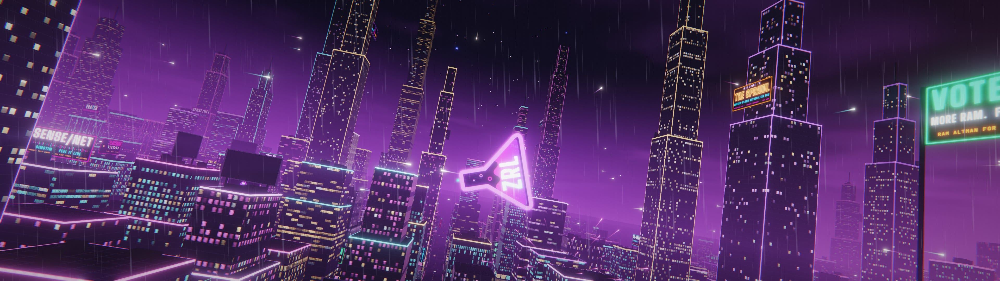
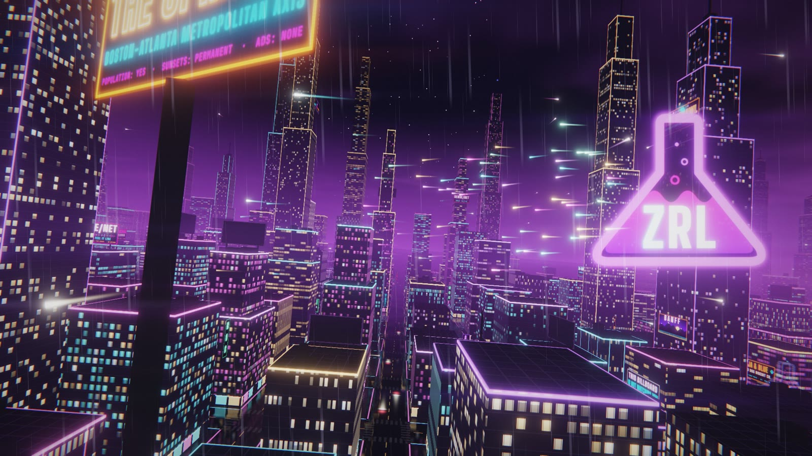
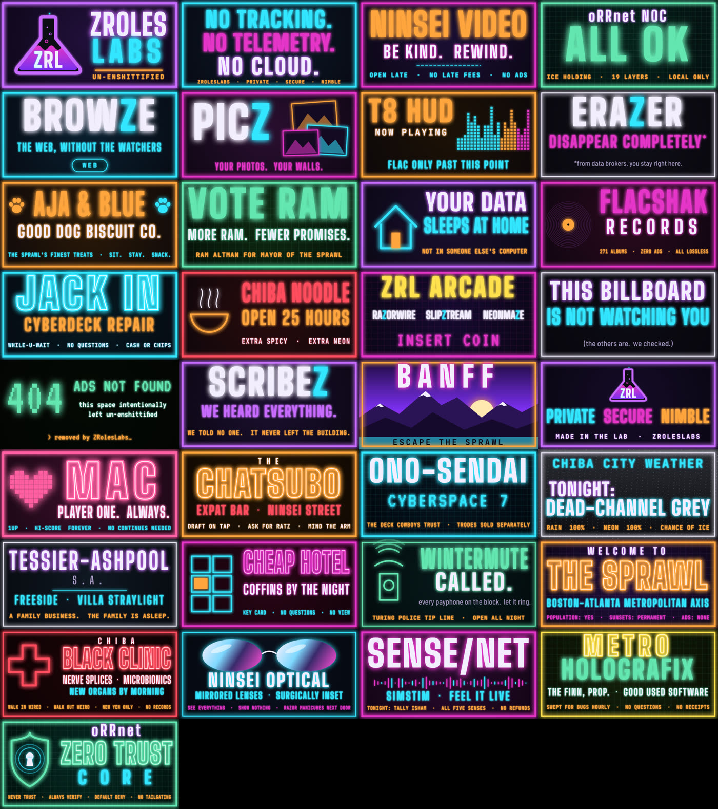

# ZRL Sprawl

An un-enshittified screensaver for Windows. A slow night flight over a neon city that never ends, in real time, across every monitor you have, with the ZRolesLabs flask tumbling through it. No network, no telemetry, no account, no audio, and the only ads are the fake ones on the billboards.



- **Every monitor, one picture.** The city stretches across all your screens as a single view. On two monitors the flask crosses the gap between them; on one screen it treats the middle as the gap.
- **Three acts, on a loop.** The flask sails across flipping like a coin, then drops in as a real rigid body that falls, tumbles and bounces off the edges of your desktop, then breaks into light and re-forms on the other side.
- **Drawn live, not a video.** It's a small WebGL city rendered by your graphics card, so it is sharp at any resolution. It lowers its own resolution a little when a small GPU can't keep up.
- **Billboards worth reading.** Rain, traffic, and a few dozen signs for businesses that don't exist.



> **Got an Eversolo streamer?** The same flight runs as the screensaver on its screen: see [ZRL Sprawl for Eversolo](eversolo/).

## Install it (about 2 minutes)

**You need:** Windows 10 or 11, 64-bit. That's it for most PCs. See [What it needs](#what-it-needs) if it doesn't start.

1. **Download** [`ZRL-Sprawl.zip`](https://github.com/ZRolesLabs/zrl-sprawl/releases/latest/download/ZRL-Sprawl.zip) from the latest release.
2. **Unblock the zip.** Right-click the downloaded zip, choose **Properties**, tick **Unblock** at the bottom, press **OK**. This tells Windows you trust the download. If you skip it, see [the SmartScreen box](#the-windows-protected-your-pc-box) below.
3. **Extract it somewhere it can stay.** Right-click the zip, choose **Extract All…**, and pick a folder you won't tidy away, for example `C:\Users\<you>\ZRL-Sprawl`. Don't run it from inside the zip, and don't move the folder afterwards: Windows remembers where the screensaver lives.
4. **Install.** Open the extracted `ZRL-Sprawl` folder, right-click **`ZRL-Sprawl.scr`** and choose **Install**. On Windows 11, choose **Show more options** first.
5. **Set the wait.** Windows opens Screen Saver Settings with ZRL-Sprawl already picked. Choose how many minutes to wait and press **OK**. The little monitor picture in that window stays blank; press **Preview** to see the real thing.

To just watch it without installing, double-click `ZRL-Sprawl.scr`. Any key, click or mouse movement closes it.

### The "Windows protected your PC" box

ZRL Sprawl is not code-signed. A signing certificate costs a few hundred dollars a year, and this is a free hobby project, so Windows SmartScreen doesn't recognise the file and shows a blue box the first time you run it.

- If you unblocked the zip in step 2, you won't see the box.
- If you do see it: click **More info**, then **Run anyway**.

You don't have to take our word for what's inside. The zip is built from the source in this repository by GitHub Actions ([the workflow](.github/workflows/build.yml)), each release lists the zip's SHA-256, and you can [build it yourself](#build-it-yourself).

### Remove it

Open Screen Saver Settings (press Start and type "screen saver"), pick another screensaver or **(None)**, then delete the `ZRL-Sprawl` folder. The view keeps a small cache in `%LOCALAPPDATA%\ZRolesLabs\zrl-sprawl-wv2`; delete that too if you like. Nothing else is left behind: no service, no startup entry, no admin rights.

## What it needs

- **Windows 10 or 11, 64-bit.**
- **Microsoft Edge WebView2 Runtime.** It's part of Windows 11 and of any Windows 10 that has had its updates. If the screensaver shows "could not start its view (WebView2)", install the Evergreen runtime from [Microsoft's WebView2 page](https://developer.microsoft.com/microsoft-edge/webview2/).
- **A graphics card from the last ten years or so.** Integrated graphics are fine. It was built and tested on a mini PC with Ryzen 5 5500U integrated graphics driving two 1080p monitors at 60 frames a second.

It works the graphics card the whole time it's up, so on a laptop running on battery you may prefer a short display-off time after it.

## Privacy

- The screensaver makes **no network requests**. It shows local files from its own folder, and the program refuses every request that isn't one of those files ([see the source](windows/saver.cs)).
- No telemetry, no analytics, no update check, no account.
- It writes only to the cache folder named above and, if it ever fails to start, a short error note in your temp folder.
- The picture is drawn by Microsoft's WebView2 runtime, which is a Microsoft component already on your PC. ZRL Sprawl starts it with background networking and sync switched off.

## Options

There's nothing to configure in Windows' Settings button. For tinkerers, a plain text file named `options.txt` next to `ZRL-Sprawl.scr` changes how it runs. Put the options on one line, joined with `&`.

| Option | What it does |
| --- | --- |
| `fps=30` | Cap the frame rate (default 60). |
| `scale=0.75` | Fix the render resolution at this fraction instead of letting it adjust itself (0.5 to 1). |
| `world=60` | Redraw the city every frame instead of every other frame. Smoother, and noticeably more work for the GPU. |
| `logo=0` | No flask, just the city. |
| `act=1` | Start with a chosen act: `0` sail across, `1` bounce, `2` break into light. |
| `rand=1` | Start at a random point of the flight instead of the beginning. |

**The flight.** For a faster, cinematic fly-through with no flask, put this in `options.txt`:

```
T=150&world=60&logo=0&rain=.7&grain=.004&hfov=59&rand=1&scale=.72
```

## The billboards



Some advertise ZRolesLabs projects, some are in-jokes, and a good many are a fan's tribute to William Gibson's Sprawl novels, where this kind of city was first imagined. Only the names are borrowed; every tagline is our own. ZRL Sprawl is not affiliated with or endorsed by William Gibson or his publishers.

## Build it yourself

You need mono's C# compiler (`mcs`), `curl`, `unzip` and `zip`. On Ubuntu or Debian:

```
sudo apt-get install mono-mcs zip unzip curl
./build.sh
```

That fetches the WebView2 SDK from NuGet (pinned by checksum), compiles `windows/saver.cs`, and writes `ZRL-Sprawl.zip`. The city itself is the plain JavaScript in `sprawl/`: `atlas.js` paints the billboards, `sprawl.js` is the city and the flight, `logo.js` is the flask, `main.js` drives the page. You can open `sprawl/index.html` through any local web server to watch it in a browser.

## Bugs, questions and ideas

Open an issue: **[github.com/ZRolesLabs/zrl-sprawl/issues](https://github.com/ZRolesLabs/zrl-sprawl/issues)**. For a problem, say which Windows version, which graphics card, and how many monitors at what resolution. For the Eversolo version, say which streamer and firmware.

## License

MIT. Third-party parts (the WebView2 SDK and the fonts) keep their own licences: see [THIRD-PARTY-NOTICES.md](THIRD-PARTY-NOTICES.md).
