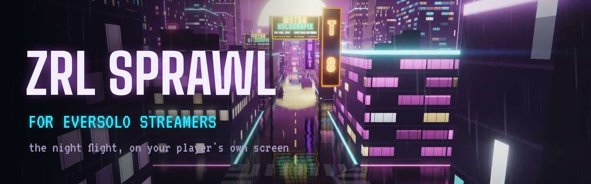

**ZRL Sprawl for Eversolo 1.0.0**: the Sprawl night flight as the screensaver on an Eversolo streamer's own screen. Silent, no permissions (not even internet), nothing to configure.

Tested on the Eversolo DMP-T8 with firmware 1.6.15. Other Eversolo streamers with an Android screen will probably work, but we haven't tried them: [tell us](https://github.com/ZRolesLabs/zrl-sprawl/issues) if you do.

**Install:** download `zrl-sprawl-eversolo.apk` below. On a computer on the same network, open `http://<your streamer's IP>:18888` (Eversolo's own installer page) and upload it. Then on the streamer open the **ZRL Screensaver** tile, tap **CHOOSE SCREENSAVER** and pick **ZRL Sprawl**. Full steps, removal, caveats and a copy-paste prompt that lets an AI walk you through it are in the [Eversolo README](https://github.com/ZRolesLabs/zrl-sprawl/tree/main/eversolo).

Unofficial: not made, checked or supported by Eversolo. The app code is built from this repository by GitHub Actions; the film is rendered from the repository's `sprawl/` engine, added to the app, and the APK is signed with the ZRolesLabs key.

Looking for the Windows screensaver? It's in the [latest release](https://github.com/ZRolesLabs/zrl-sprawl/releases/latest).
