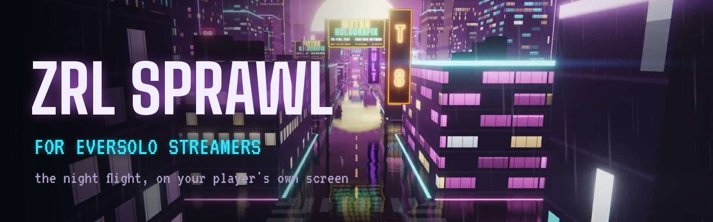
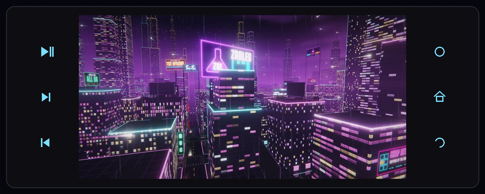
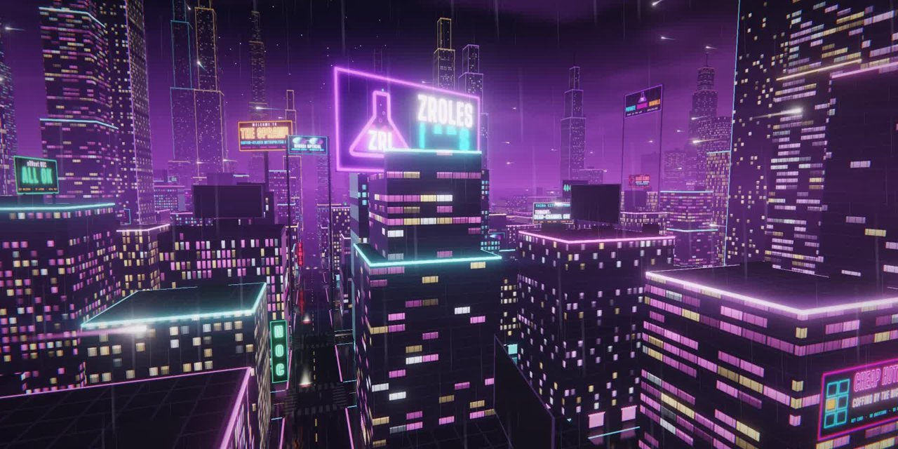
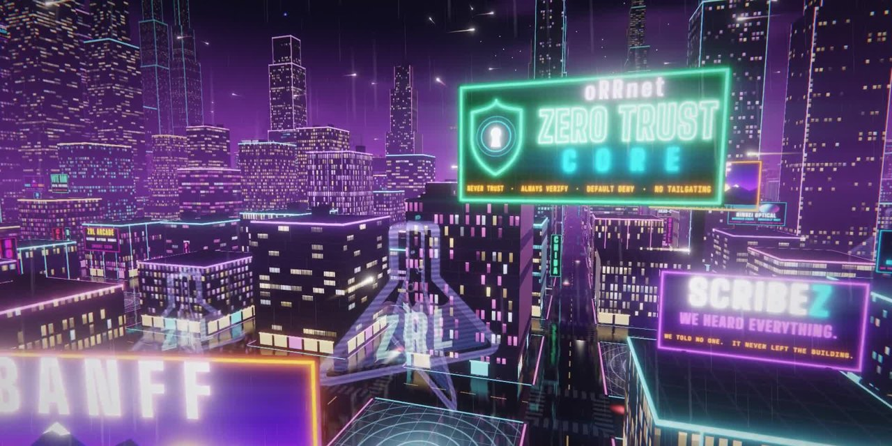
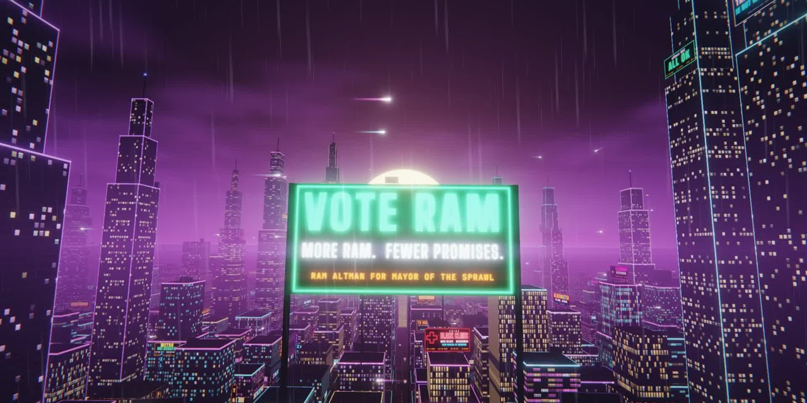

# ZRL Sprawl for Eversolo



The ZRL Sprawl night flight as the screensaver on an Eversolo streamer's own screen. When the player sits idle, the screen flies you through the neon city instead of showing the stock screensaver. Silent, no network, no account, nothing to configure.

It's an ordinary Android screensaver app. Eversolo streamers run Android, and Eversolo's own tutorials show how to add apps to them, so nothing is hacked, rooted or unlocked.


<sub>Illustration: a real frame of the film on a DMP-T8-style front panel.</sub>

- **Tested on:** Eversolo DMP-T8, firmware 1.6.15 (2160×1080 touch screen).
- **Probably works on:** other Eversolo streamers with an Android screen and the same web installer. We haven't tried them. If you do, [tell us how it went](https://github.com/ZRolesLabs/zrl-sprawl/issues).
- **Size:** about 165 MB, almost all of it the film.

## What you'll see

A 150-second flight through a rainy neon city that loops without a seam. The billboards are for businesses that don't exist (and a few ZRolesLabs projects).

| | |
|---|---|
|  |  |
|  |  |

## Install it (about 5 minutes)

**You need:** the streamer switched on and awake (not in standby), and a computer on the same home network.

1. **Download** [`zrl-sprawl-eversolo.apk`](https://github.com/ZRolesLabs/zrl-sprawl/releases/download/eversolo-v1.0.0/zrl-sprawl-eversolo.apk) onto the computer.
2. **Find the streamer's IP address.** It's in the streamer's network settings, and your router's list of devices shows it too. It looks like `192.168.1.50`.
3. **Open Eversolo's installer page.** In the computer's web browser, go to `http://<the streamer's IP>:18888`, for example `http://192.168.1.50:18888`. This page is part of Eversolo's firmware; it's the one their "third-party input method" tutorial uses.
4. **Upload the APK.** Pick `zrl-sprawl-eversolo.apk` on that page and send it. The streamer installs it by itself. Give it 30 seconds or so; the page doesn't say when it's done.
5. **On the streamer:** open the **Apps** screen. You'll see a new tile, **ZRL Screensaver**. Tap it.
6. Tap **PREVIEW** to see the flight. Tap the screen to close it.
7. Tap **CHOOSE SCREENSAVER**. Android's screensaver list opens. Pick **ZRL Sprawl**, then go back.
8. **Set the wait.** Eversolo's own **Settings → Display → Screensaver** time still decides how long the player waits before the screensaver starts.

**No computer handy?** Copy the APK to a USB stick, plug it into the streamer, and open it with the streamer's file manager. If the file manager only shows music, turn off its "music files only" option in Settings.

### Remove it

Open the **ZRL Screensaver** tile, tap **CHOOSE SCREENSAVER**, and pick the Eversolo screensaver again. Then press and hold the **ZRL Screensaver** tile in the Apps screen and uninstall it. Nothing else is left behind.

## Privacy and what it can touch

- The app asks for **no permissions at all**, not even internet access. Android won't let it open a network connection, so it can't phone home, update itself, or track anything.
- It never touches audio. It doesn't play sound, read what's playing, or change any player setting.
- It changes no settings by itself. You choose it in Android's own screensaver list, and you can choose something else the same way.

## Honest caveats

- **Unofficial.** ZRolesLabs is a hobby lab, not Eversolo. Eversolo doesn't make, check or support this app, so don't ask them about it. A firmware update could change how screensavers work.
- **Sideloaded.** Any app from outside an app store deserves a look before you install it. You can check this one three ways:
  - The app's code is in this folder, and GitHub Actions builds it from source on every change ([the workflow](../.github/workflows/eversolo.yml)).
  - The film is rendered from the same `sprawl/` engine as the Windows screensaver, by [`film/render.sh`](film/render.sh).
  - Each release lists the APK's SHA-256. The release APK is signed with the ZRolesLabs key, so its signature won't match a copy you build yourself.
- **The film is a loop.** It's 150 seconds long and loops seamlessly. Unlike the Windows version, it's a video, not drawn live, so the streamer's processor doesn't work hard.
- **Wide screens trim a little.** The film is 16:9. On the DMP-T8's 2:1 screen it fills the width and trims a sliver off the top and bottom, so nothing is stretched.

## Let an AI help

Not a settings person? Copy this into an AI assistant like [Claude](https://claude.ai/) and it walks you through, one step at a time.

```text
I want to install ZRL Sprawl for Eversolo
(https://github.com/ZRolesLabs/zrl-sprawl/tree/main/eversolo), a screensaver
app for my Eversolo streamer's screen. It's not in any app store: it's an APK
from GitHub Releases that I send to the streamer from my computer's browser.

My streamer is: [e.g. Eversolo DMP-T8]
My computer is: [Windows / Mac / Linux]
  (if I left either blank, ask me first)

Read the "Install it" section of that README first and follow it. If you
can't open web pages, say so and I'll paste that section in for you.

I'm not technical. Walk me through it ONE step at a time and wait for my
reply after each step. Start every step with the device it happens on,
e.g. "[Computer]" or "[Streamer]". Give exact menu names and the exact text
to type, never "something like". If what I see doesn't match, ask me to
describe or photograph the screen before guessing.

Steps to cover:
1. Download zrl-sprawl-eversolo.apk from the README's link.
2. Find my streamer's IP address (its network settings, or my router's
   device list).
3. Open http://<that IP>:18888 in my computer's browser and upload the APK.
   The page won't say when it's done: tell me to wait about 30 seconds.
4. On the streamer: open the ZRL Screensaver tile in the Apps screen,
   press PREVIEW, then CHOOSE SCREENSAVER and pick ZRL Sprawl.
5. Show me where Eversolo's Settings set how long it waits before the
   screensaver starts.

If the installer page doesn't open, check the streamer is awake (not in
standby) and on the same network as my computer, then ask me what the
browser shows.
```

## Build it yourself

You need JDK 17 and Gradle 8.x with the Android SDK (or Android Studio).

```
gradle -p eversolo assembleRelease
```

That builds the app without the film, signed with your Android debug key. To render the film and add it, see [`film/render.sh`](film/render.sh). It needs node with Playwright, ffmpeg, and python3 with `cryptography`. On a CPU it takes hours.

## License

MIT, like the rest of this repository.
